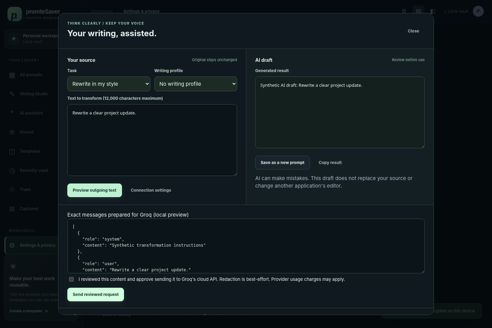

# promteSaver v0.9 - Capture & AI Developer Pilot

**Remember approved browser prompts. Find them locally. Review AI help before sending or saving.**

This release adds actual opt-in browser capture source and a Groq transformation pipeline to the encrypted local workbench. It corrects a major gap in earlier releases: v0.8 was a manual library/writing workspace, **not** the automatic recorder described in the product vision.

**Distribution:** runnable source for a local HTTP application plus an unpacked Chrome/Edge companion. The experimental Tauri desktop host remains uncompiled here. **There is no verified Windows EXE/MSI or macOS app/DMG in this ZIP.** No GitHub push, live website capture certification or live Groq call is implied.

[Start the pilot](docs/PILOT_GUIDE_V0_9.md) | [Exact feature status](docs/READINESS_V0_9.md) | [Verification](docs/TEST_REPORT_V0_9.md) | [Architecture](docs/ARCHITECTURE_V0_9.md) | [Release notes](docs/RELEASE_NOTES_V0_9.md)



## What is implemented, and what is not

| Workflow | Implemented source | Verification / limit |
| --- | --- | --- |
| Local prompt library | Encrypted payloads, search, projects, tags, templates, history, Trash, draft recovery, backup, writing profiles | Real storage/HTTP tests plus actual Chromium UI fixtures; not Windows/Mac device certified |
| Automatic browser capture | Opt-in send-click/Enter snapshots on known ChatGPT, Claude and Gemini composers; source host recorded | Real recorder code tested on synthetic DOM fixtures; real site layouts and installed MV3 extension remain unverified |
| Inline writing hints | Debounced local checks for repeated words, spaces, punctuation and missing output-format guidance | Limited English heuristics; no AI autocomplete, automatic replacement or system-wide popup |
| Groq AI | Explicit summary, prompt structuring, improvement and style-guided rewriting | Real request-building/backend tests with mocked provider; no real credential or live provider test here |
| Source preservation | Immutable captured evidence plus separate editable copy and separate AI result | Tested links, tombstones, backup restore and deletion |
| Universal desktop recording | Not implemented | VS Code/Cursor/terminal/Word/native AI applications are not covered |
| Native installers / OS keychain / whole-DB encryption | Experimental host source / not implemented / not implemented | Public desktop release gates are open |

A snapshot at a send action is **not proof of model delivery**. Capture is labelled `draft_snapshot`, never `exact_submitted`. An Enter key may create a newline in a site-specific configuration. No whole-page history, full source URL, screenshot, audio, clipboard polling or arbitrary keystrokes are recorded.

## Run the local application

Back up the **complete stopped-service vault folder** before upgrading. Extract into a new folder. Use a trusted Node.js **24.16 or newer within 24.x**. No production npm install is needed.

Windows PowerShell, inside `promteSaver`:

```powershell
.\start-windows.ps1
```

macOS Terminal:

```sh
sh ./start-mac.command
```

Open the private `127.0.0.1` URL printed in the terminal. Keep the terminal running; stop with Ctrl+C. That URL contains a session capability: **never share it or include it in screenshots/support logs**. The default vault is `~/.promtesaver-local` (under your Windows user home too). It is not a public site or LAN/mobile service.

Node 22.16+ is an explicitly warned development-compatibility fallback. Verification here used Linux/Node 22.16.0, not the pinned Node 24/TypeScript toolchain or target operating systems.

## Enable the browser companion deliberately

1. Load `apps/browser-helper` as an unpacked extension in Chrome or Edge developer mode. It is not a browser-store release.
2. Unlock the vault. In Settings, approve browser send snapshots and generate a pairing code. Paste it into the extension popup.
3. Open a supported site, choose **Enable for this site**, approve that site's optional permission, and separately enable local hints if desired.
4. Test with nonsensitive sample text. The visible panel reports success or failure. In the app, refresh the library and select project **Browser inbox**; **Captured** contains the original evidence.

Pairing is write-only, bound to the extension origin, valid for at most eight hours and revoked on lock/restart/re-pair. **The vault's default 15-minute idle lock still applies; capturing does not silently disable or renew it.** When locked, stopped, unpaired, expired or unreachable, prompts are **not saved or queued**. Pause stops future attempts, not requests already accepted by the service. See [the pilot guide](docs/PILOT_GUIDE_V0_9.md) for the full acceptance checklist and known exclusions.

## Use Groq locally configured, never pasted into chat

In Settings, enter your own Groq API key on your computer and explicitly enable the connection. The key is encrypted in the vault, is never sent to the extension, and is excluded from portable backups. This build contains no real key. Default model: `llama-3.3-70b-versatile`; an available model ID can be chosen locally.

Open **AI assistant** or a prompt's **AI assist** action. Choose summarize, structure, improve or rewrite; optionally select a writing profile. Preview the exact messages, review redactions, approve the cloud send, then review the result. Saving creates a separate labelled AI draft. It never overwrites evidence or edits another app.

No cloud request happens just because a prompt was captured or someone typed. A request is rejected when text, profile, model, settings or unlocked session no longer match its preview. Raw writing examples are not sent by this integration. User-entered preferences may contain personal information: inspect the preview. Redaction is not a guarantee that all secrets are detected. Provider policies/charges apply; cancellation cannot withdraw a request already received by the provider.

## Verification in this release

- **145/145 Node tests passed:** real encrypted storage and local HTTP tests; provider transport is mocked; seven worker tests use Chrome API doubles.
- **21/21 baseline Chromium fixture scenarios passed**, plus **23/23 new assistant/recorder fixture scenarios**.
- Offline TypeScript 5.8.3 checking, browser JavaScript syntax, contract generation and version checks passed.
- Live Chromium-to-localhost navigation was administratively blocked. A real unpacked MV3 worker probe timed out without observing a service worker. No browser policy was changed.
- Native compilation, installation, live AI-site layouts, a real Groq response and low-memory Windows/Mac behavior were **not verified**.

These are not 44 live end-to-end tests. See raw outputs and exact reproduction commands in [the test report](docs/TEST_REPORT_V0_9.md).

## Resource choices and observed limits

No new production npm dependencies, bundled model, provider SDK, polling recorder, DOM mutation observer or second service process. Hints run at most after a 900 ms typing pause on an opted-in known composer. One AI call at a time, six per minute, 12 s timeout, bounded input/output and no automatic retries. The worker allows two in-flight local captures, no queue, a four-second timeout and bounded responses. The service caps bridge writes at 15/minute.

A 300-record Linux test measured **123.45 MiB sampled Node RSS**, **163.39 ms service readiness**, and **0.0% sampled idle CPU over four seconds**. This excludes the browser and is not peak memory or a zero-CPU guarantee. A separate 2,000-record Chromium fixture measured **554.53 MiB browser process-tree RSS**; not incremental extension memory or native WebView memory. No low-spec hardware guarantee or whole-app memory reduction is established.

## Data and upgrade boundaries

Key envelope stays v2. Portable snapshots are v3 without linked captures and v4 when capture/library links exist. v4 includes links and deletion evidence; imports accept v1-v4. Older releases cannot be assumed to restore v4 or preserve links. Do not downgrade an active vault; restore a separate pre-upgrade full-folder backup instead. Groq credentials are absent from portable snapshots but present encrypted in full-folder copies. Removing a saved key does not revoke it at the provider or erase old backups.

SQLite payloads use AES-256-GCM, but database structure/metadata are not fully encrypted and there is no OS keychain. Deletion does not prove physical erasure from SSDs or backups. See [privacy and security](docs/PRIVACY_AND_SECURITY.md).

## Development

```sh
npm ci --ignore-scripts
npm run check
npm run test:core
python scripts/browser-smoke.py --mode fixture --output qa-baseline
python scripts/core-browser-tests.py --output qa-core
python scripts/browser-smoke.py --mode live --output qa-live
python scripts/extension-worker-check.py
```

Playwright, Chromium and psutil are development/testing tools, not application dependencies. Native build attempts are documented in [DESKTOP_BUILD.md](docs/DESKTOP_BUILD.md); source staging is not native compilation. Read [AGENTS.md](AGENTS.md) and [HANDOFF.md](docs/HANDOFF.md). Keep real vaults, credentials and runtime binaries out of source control. Original source licensing and signed distribution remain maintainer release decisions.
