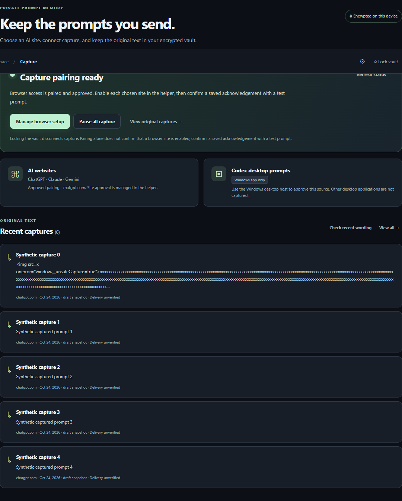

# promteSaver v0.9 - Windows Capture Developer Preview

**Remember new prompts from approved sources, preserve the saved snapshot, and review it locally.**

The product priority is a native Windows prompt memory app. The current local increment adds a compiled Windows preview and a capture-first screen. The existing browser helper can capture send-intent snapshots after site approval. An experimental Codex transcript producer exists in synthetic tests but is disabled for real sessions until private/protected-session exclusions can be verified. The local library and optional AI tools support the capture flow.

**Next product direction:** one desktop setup with source-specific native capture, so customers do not have to install an unpacked browser extension as the normal first step. This native cross-app capture is a target, not a shipped feature. The current browser helper remains an optional developer preview path; no indiscriminate keyboard recording is enabled.

**Current build:** a locally compiled, unsigned Windows preview is at [`.local/windows-preview/promteSaver.exe`](.local/windows-preview/promteSaver.exe), with a [portable ZIP](.local/promteSaver-windows-preview-2026-10-25-startup.zip) containing the supported Node runtime and browser helper. The ZIP was extracted and passed a temporary-vault self-test on this Windows machine. The native window has no passphrase prompt: it creates a separate encrypted vault with a random secret protected by the signed-in Windows account. The earlier passphrase vault stays untouched. **This is not a tested installer or consumer release.** `.local` is ignored by Git, so a source ZIP needs a local build. The Tauri host remains uncompiled; there is no macOS app/DMG. Real third-party site capture, live Groq and clean-device installation remain open. [Product direction](docs/PRODUCT_DIRECTION.md).

[Windows preview setup](docs/WINDOWS_DESKTOP_PREVIEW.md) | [Pilot checklist](docs/PILOT_GUIDE_V0_9.md) | [Exact feature status](docs/READINESS_V0_9.md) | [Complete backlog](docs/PRODUCT_BACKLOG.md) | [Verification](docs/TEST_REPORT_V0_9.md) | [Architecture](docs/ARCHITECTURE_V0_9.md) | [Release notes](docs/RELEASE_NOTES_V0_9.md)



## Try the Windows preview

Open [promteSaver.exe](.local/windows-preview/promteSaver.exe) from its folder, keeping `runtime/`, `binaries/`, `browser-helper/`, icon and config beside it. Click **Create vault** once, then choose a capture source. On later launches or after idle lock, click **Open vault**; no password is requested. The new desktop vault lives in `%LOCALAPPDATA%\promteSaver\desktop-vault`, separate from the prior `%USERPROFILE%\.promtesaver-local` passphrase vault. Back up the complete desktop vault, including `desktop-credential.bin`, before changing Windows accounts or devices; the protected credential does not travel to another account by itself. The app shows approved-source status, recent saved snapshots and an explicit **Review recent wording** action. Closing the window keeps the tray app running; use the tray's **Quit** action to stop it.

The optional **Start with Windows** checkbox adds a per-user login launch for this portable EXE. It is off by default and does not open the vault or reconnect browser capture at sign-in. Moving the portable folder requires turning the checkbox off before the move and on again afterward. Continuous all-day capture is not established: the vault locks after 15 idle minutes and browser pairing is revoked on lock.

Codex transcript capture is disabled in the preview. Its local file format and private/protected-session signals have not been verified. Synthetic injected-directory tests exercise the producer without reading real user sessions.

For browser capture, load `browser-helper/` from the preview folder as an unpacked Chrome/Edge extension. In the native app select **ChatGPT**, **Claude** or **Gemini**, click **Connect browser**, copy the one-time code into the helper, then enable that same site and grant its permission. Test with harmless text and confirm a saved acknowledgement. The browser extension remains a separate component; neither a site permission nor capture starts on launching the app.

The native preview does not automatically rewrite prompts at the end of the day. **Review recent wording** runs bounded offline spacing/repetition/punctuation checks only when clicked and leaves saved snapshots intact. Automatic AI grammar review and Grammarly-style suggestions in other apps remain planned. The default 15-minute vault idle lock revokes capture approval, so unattended all-day capture is not established.

## What is implemented, and what is not

| Workflow | Implemented source | Verification / limit |
| --- | --- | --- |
| Windows desktop preview | Native WinForms executable, one-click Windows-protected vault, private Node service, lock, tray pause/quit, per-site browser approval, captured history and explicit local wording review | Compiled and smoke-tested on Windows with a temporary vault; unsigned portable folder, not clean-device installer evidence |
| Codex desktop source | Experimental producer for new local `user_message` transcript events, disabled for real sessions | Real Windows filesystem watching on synthetic fixtures only; private/protected-session exclusions and actual Codex compatibility are unverified |
| Local prompt library | Encrypted payloads, search, projects, tags, templates, history, Trash, draft recovery, backup, writing profiles | Real storage/HTTP tests plus actual Chromium UI fixtures; not Windows/Mac device certified |
| Related prompt recall | From a draft in the vault editor, click **Find related saved prompts** to see local keyword matches with source context and add a chosen prompt to the draft | Explicit local action; no learned patterns, automatic suggestions or extension read access |
| Automatic browser capture | Opt-in send-click/Enter snapshots on known ChatGPT, Claude and Gemini composers; source host recorded | Real recorder code tested on synthetic DOM fixtures; real site layouts and installed MV3 extension remain unverified |
| Inline writing hints | Debounced local checks for repeated words, spaces, punctuation and missing output-format guidance | Limited English heuristics; no AI autocomplete, automatic replacement or system-wide popup |
| Groq AI | Explicit summary, prompt structuring, improvement and style-guided rewriting | Real request-building/backend tests with mocked provider; no real credential or live provider test here |
| Reviewed instruction extraction | Open AI assist on a saved prompt; review a source-bound understanding; separately preview/approve exact-quote candidates; choose task/project/personal scope and save selected copies | Synthetic provider/Chromium/HTTP tests; independent editable templates, not durable learned preferences or live provider validation |
| Related results and feedback | See local keyword/source context; copy exact wording or add an editable draft copy; explicitly correct the draft project; mark the saved revision worked, not useful or hidden | Feedback is encrypted and reversible; only Hidden suppresses recall. This does not learn preferences or measure success automatically |
| Capture receipts and gaps | Captured cards explain source method, quality, time and deletion; the view pages and searches older records; Settings offers reviewed age-based cleanup. Browser popup lists up to 20 content-free failed-save reasons for its current session | Unknown editors and actual message delivery remain unverified; no failed text is queued |
| Source preservation | Immutable saved snapshot plus separate editable copy and separate AI result; obvious sensitive matches may be redacted before persistence | Tested links, tombstones, backup restore and deletion; not a byte-for-byte original or proof of delivery |
| Universal desktop recording | Not implemented | VS Code/Cursor/terminal/Word and arbitrary typing are not covered |
| Native installers / OS key protection / whole-DB encryption | Portable Windows preview only / Windows CurrentUser DPAPI protects the vault wrapping secret / not implemented | Public desktop release gates are open; the previous passphrase vault is not migrated |

A snapshot at a send action is **not proof of model delivery**. Capture is labelled `draft_snapshot`, never `exact_submitted`. An Enter key may create a newline in a site-specific configuration. No whole-page history, full source URL, screenshot, audio, clipboard polling or arbitrary keystrokes are recorded.

## Run the source/browser fallback

Back up the **complete stopped-service vault folder** before upgrading. Extract into a new folder. Use a trusted Node.js **24.16 or newer within 24.x**. No production npm install is needed.

Windows: double-click **`start-windows.cmd`** in the extracted folder. It checks Node, runs from the correct folder and keeps startup errors visible. Keep its console window open while using the app; open the private browser address it prints. No PowerShell policy change is needed. Starting the app does not enable capture.

Alternatively, in PowerShell inside `promteSaver`, run the saved script (do not paste its contents):

```powershell
.\start-windows.ps1
```

macOS Terminal:

```sh
sh ./start-mac.command
```

Open the private `127.0.0.1` URL printed in the terminal. Keep the terminal running; stop with Ctrl+C. That URL contains a session capability: **never share it or include it in screenshots/support logs**. The default vault is `~/.promtesaver-local` (under your Windows user home too). It is not a public site or LAN/mobile service.

Node 22.16+ is an explicitly warned development-compatibility fallback, not the Windows preview runtime. The current native preview uses Node 24.16.0. See the test report for historical runs on other runtimes.

## Enable the browser companion deliberately

1. Load the portable preview's `browser-helper/` folder, or `apps/browser-helper` when using the source fallback, as an unpacked extension in Chrome or Edge developer mode. It is not a browser-store release.
2. Unlock the vault. In the native preview use **Connect browser**; in the source fallback use Settings. Generate a one-time pairing code and paste it into the extension popup.
3. Open a supported site, choose **Enable for this site**, approve that site's optional permission, and separately enable local hints if desired.
4. Test with nonsensitive sample text. The visible panel reports success or failure. The native preview shows recent saved snapshots; the source UI's **Captured** view contains that evidence and **Browser inbox** holds editable copies.

Pairing is write-only, bound to the extension origin, valid for at most eight hours and revoked on lock/restart/re-pair. **The vault's default 15-minute idle lock still applies; capturing does not silently disable or renew it.** When locked, stopped, unpaired, expired or unreachable, prompts are **not saved or queued**. Pause stops future attempts, not requests already accepted by the service. See [the pilot guide](docs/PILOT_GUIDE_V0_9.md) for the full acceptance checklist and known exclusions.

## Use Groq locally configured, never pasted into chat

In Settings, enter your own Groq API key on your computer and explicitly enable the connection. The key is encrypted in the vault, is never sent to the extension, and is excluded from portable backups. This build contains no real key. Default model: `llama-3.3-70b-versatile`; an available model ID can be chosen locally.

Open **AI assistant** or a prompt's **AI assist** action. Choose summarize, structure, improve or rewrite; optionally select a writing profile. Preview the exact messages, review redactions, approve the cloud send, then review the result. Saving creates a separate labelled AI draft. It never overwrites evidence or edits another app.

No cloud request happens just because a prompt was captured or someone typed. A request is rejected when text, profile, model, settings or unlocked session no longer match its preview. Raw writing examples are not sent by this integration. User-entered preferences may contain personal information: inspect the preview. Redaction is not a guarantee that all secrets are detected. Provider policies/charges apply; cancellation cannot withdraw a request already received by the provider.

## Current verification (25 October 2026)

- **Tested locally on Windows:** the native WinForms executable compiled and its owned Node service accepted a harmless simulated browser send into a temporary encrypted vault. Its self-test covered Windows-protected credential tamper/missing cases, wrong secret, lock/unlock and extracted ZIP relocation. `npm run check` passed **186/186 Node tests**; `npm run desktop:verify` checked 42 staged files.
- **Synthetic browser evidence:** **30/30** actual-UI fixture scenarios, **20/20** UI-to-temporary-local-service scenarios (one accelerated idle scenario is fixture-only), and **53/53** core UI/recorder scenarios passed in Chromium. The recorder's composer pages and provider are synthetic.
- **Unverified in real use:** actual Codex session format/private-mode exclusions, human-granted site permissions and capture on live ChatGPT/Claude/Gemini pages, a live Groq request, clean-device install/uninstall and whole-app resources on low-memory Windows/macOS devices. Chrome access later became available, but Browser Use blocked the extension setup URL by policy. No helper was installed or real prompt sent by this test; manual helper loading is needed before the live-site check can continue.
- **Windows login launch:** compiled, visible in a synthetic native window and present in the extracted portable package; changing the checkbox and reboot/login behavior have not been exercised. The current machine's setting remains off.
- **Not implemented:** real Codex transcript capture, automatic capture from arbitrary desktop apps, an end-of-day AI grammar pass, suggestions inside other apps, automatic capture resume after login, signed installer and macOS app.

The original v0.9 report and earlier local runs remain in [the dated test report](docs/TEST_REPORT_V0_9.md); their counts and blocked-browser results are historical, not the latest Windows outcome.

## Resource choices and observed limits

No new production npm dependencies, bundled model, provider SDK, polling recorder or DOM mutation observer. The native preview owns one local Node sidecar and stops it on Quit. Hints run at most after a 900 ms typing pause on an opted-in known composer. One AI call at a time, six per minute, 12 s timeout, bounded input/output and no automatic retries. The worker allows two in-flight local captures, no queue, a four-second timeout and bounded responses. The service caps bridge writes at 15/minute.

A 300-record Linux test measured **123.45 MiB sampled Node RSS**, **163.39 ms service readiness**, and **0.0% sampled idle CPU over four seconds**. This excludes the browser and is not peak memory or a zero-CPU guarantee. A separate 2,000-record Chromium fixture measured **554.53 MiB browser process-tree RSS**; not incremental extension memory or native WebView memory. No low-spec hardware guarantee or whole-app memory reduction is established.

## Data and upgrade boundaries

Key envelope stays v2. Portable snapshots are v3 without linked captures and v4 when capture/library links exist. v4 includes links and deletion evidence; imports accept v1-v4. Older releases cannot be assumed to restore v4 or preserve links. Do not downgrade an active vault; restore a separate pre-upgrade full-folder backup instead. Groq credentials are absent from portable snapshots but present encrypted in full-folder copies. Removing a saved key does not revoke it at the provider or erase old backups.

SQLite payloads use AES-256-GCM, but database structure/metadata are not fully encrypted. The native Windows preview protects its random vault wrapping secret with CurrentUser DPAPI; the older source/browser fallback still requires a user passphrase. Deletion does not prove physical erasure from SSDs or backups. See [privacy and security](docs/PRIVACY_AND_SECURITY.md).

## Development

```sh
npm ci --ignore-scripts
npm run check
npm run test:core
python scripts/browser-smoke.py --mode fixture --output qa-baseline
python scripts/core-browser-tests.py --output qa-core
python scripts/browser-smoke.py --mode live --output qa-live
python scripts/extension-worker-check.py
```

Playwright, Chromium and psutil are development/testing tools, not application dependencies. The C# Windows preview is native compilation; the separate Tauri source is still uncompiled. Build and packaging limits are documented in [DESKTOP_BUILD.md](docs/DESKTOP_BUILD.md) and [Windows preview setup](docs/WINDOWS_DESKTOP_PREVIEW.md). Read [AGENTS.md](AGENTS.md) and [HANDOFF.md](docs/HANDOFF.md). Keep real vaults, credentials and runtime binaries out of source control. Distribution licensing and signed release remain maintainer decisions.
