# Architecture: delivered local preview and proposed native platform

**Updated:** 22 October 2026. This document distinguishes **implemented** from **planned** components.

## Layer map

```mermaid
flowchart TB
  subgraph Delivered[Implemented in this ZIP]
    Browser[Local browser UI<br/>vanilla JS, CSS, HTML]
    Helper[Chrome/Edge MV3 helper<br/>user-triggered only]
    API[Node built-in HTTP<br/>loopback + session token]
    Key[Local passphrase manager<br/>scrypt key memory]
    Encrypted[EncryptedArchive<br/>AES-GCM SQLite payloads]
    Synthetic[CaptureEngine<br/>synthetic snapshots]
    Browser --> API --> Key --> Encrypted
    Synthetic --> Encrypted
    Helper -.->|manual copy + paste| Browser
  end
  subgraph Future[Planned, not built]
    Win[Windows UI Automation adapters]
    Mac[macOS accessibility adapters]
    Tauri[Tauri 2 + Rust host]
    Keychain[OS keychain + SQLCipher proof]
    Sync[Optional zero-trust sync service]
    AI[Scoped opt-in AI refiners]
    Win --> Tauri
    Mac --> Tauri
    Tauri --> Keychain
    Keychain -.-> Sync --> AI
  end
```



## Delivered modules

| Path | Role | Network access |
| --- | --- | --- |
| `apps/local-web/server.ts` | Authenticated local HTTP service, input caps, Origin and Host checks, no-cache headers, CSP; dynamic port | 127.0.0.1 only |
| `apps/local-web/vault.ts` | Creates a passphrase-derived archive key using scrypt, stores non-secret salt, unlock/lock with retry delay | None |
| `apps/local-web/public/` | Responsive prompt library, template editor, search, settings, keyboard navigation, preview/clipboard | Connects only to local service |
| `packages/local-store/archive.ts` | AES-256-GCM record envelopes; new editable encrypted library table; original immutable capture records/outbox kept | None |
| `packages/capture-core/*` | Synthetic reconciling, allowlist-first policy, redaction; stronger quality classification | None |
| `packages/contracts/*` | Checked-in JSON schema, generated TS types, fail-closed subset validator (no production npm dependency) | None |
| `apps/browser-helper/` | Chrome/Edge activeTab manual editor preview and copy; no background content script or host permissions | No fetch requests |
| `scripts/bench-local.ts` | Isolated synthetic performance run; deletes temporary data | None |

The original 26-test synthetic foundation was preserved and extended, not replaced. The desktop capture engine is **not wired** to the local web service and cannot autonomously record an actual OS editor in this build.

## Local data and crypto

Default directory `~/.promtesaver-local`:

```
keyinfo.json   # version, KDF, random salt (not secret)
vault.sqlite   # SQLite header, metadata; AES-256-GCM encrypted record payloads
vault.sqlite-wal / -shm  # SQLite-managed files as needed
```

- User enters >=12-character passphrase; scrypt with N=16384, r=8, p=1 derives a 32-byte key. This is **not** an OS-keystore integration and not an Argon2id deployment.
- `EncryptedArchive` uses distinct random 96-bit nonces and record-ID-specific associated data; wrong keys and swapped/tampered ciphertext fail authentication.
- `library` row payload contains title, body, tags and project encrypted. SQL-visible IDs, kind, pin flag, timestamps, row counts, SQLite metadata and WAL structures are **not fully encrypted**.
- `records` are immutable capture evidence; `library` rows are user-editable prompt/template items, with encrypted prior versions in `library_history`. They have different lifecycle semantics by design.
- A wrong passphrase cannot be reset; loss of passphrase or `keyinfo.json` prevents recovery. Users should back up the locked database plus salt together.
- Known-secret regex filtering is defense in depth, not a guarantee. The original source text is never intentionally logged.

## Session model

At startup the Node server binds an ephemeral port on `127.0.0.1`; it prints a random session token in the fragment of a local URL. Fragment tokens are not HTTP request path parameters. UI retains the token in *sessionStorage* (not persistent localStorage) and sends it as a Bearer header. All `/api/` routes require this token. Host must equal the bound host:port; cross-origin requests with an `Origin` header are rejected. No `Access-Control-Allow-Origin` wildcard. Content Security Policy disallows remote JS/fonts/styles/resources. Cross-origin redirects are not used. Keys are kept only in the active Node process and cleared on lock/shutdown; inactivity triggers key release.

Risk note: another process on the same logged-in OS account may still be able to access the browser/session or read memory. Localhost token + app passphrase is **not a substitute for OS user isolation, a hardened installer, or formal security testing**.

## HTTP routes (implemented)

| Route | Method | Action |
| --- | --- | --- |
| `/api/status` | GET | Locked/initialized state without prompt content |
| `/api/setup` | POST | Initialize with passphrase + confirmation |
| `/api/unlock` / `/api/lock` | POST | Enter/leave unlocked state |
| `/api/summary` | GET | Library/captured aggregate counts |
| `/api/items?q=...&filter=...` | GET | Fetch at most 100 decrypted matching library items |
| `/api/items` | POST | Save encrypted prompt/template |
| `/api/items/:id` | GET / PUT / DELETE | Read, update or delete a saved item |
| `/api/items/:id/history` | GET | Retrieve up to 25 encrypted prior revisions |
| `/api/items/:id/restore` | POST | Restore a prior revision as a new editable version |
| `/api/captured` | GET | List recent immutable capture records (none by default) |
| `/api/captured/:id` | DELETE | Delete captured record and create local tombstone |
| `/api/examples` | POST | Insert three clearly synthetic examples into an empty library |

All API routes require the in-memory session bearer token. Input is JSON with a 130KB request cap; original capture contract size limit is 262KB. No public user accounts, external APIs, embeddings, analytics, or remote model calls exist.

## Search complexity and resource strategy

- Default list is SQL-limited to 100 newest/pinned items, before decrypting, preventing unbounded UI pagination work.
- Encrypted substring query iterates rows, decrypts payloads in a streaming loop, and stops after 100 matches. Runtime memory remains bounded per result, but **search complexity O(number of saved items)** is an explicit scale limitation. On 10k+ items consider keyed token hashes, an opt-in local index with documented equality leakage, or a SQLCipher-backed FTS design.
- No service worker, image inference, embeddings, audio recording, screenshots or sync background poller.
- Static UI assets are ~tens of KB and do not fetch remote fonts or libraries; Node/SQLite still have their own runtime costs.
- Future low-spec product must profile collector daemon **separately** from the on-demand UI, on actual Windows low-end x64 and Apple Silicon/Intel Mac as supported. Avoid promising a particular RAM number until measured.

## Native phase architecture (proposed)

1. **Platform adapters** behind common `EditorObservation` contract: Windows UI Automation, macOS AX, carefully scoped browser-site adapters. Use only permitted/verified prompt fields and reject private/protected/unknown contexts.
2. **Rust collector** as low-priority, event-driven service; queue bounded snapshots/metadata, not every keystroke. Backpressure and gap reporting are required. Clear drafts on focus, permission, pause, screen lock and context changes.
3. **Persistence** with SQLCipher or an independently audited equivalent, OS-protected keys, explicit deletion semantics, migration recovery, retention policies and corruption detection.
4. **Tauri 2 shell** reusing visual interaction concepts but not assuming Node local-server auth logic maps unchanged to native IPC. Default UI closed, collector status visible via menu bar/tray.
5. **Optional cloud** behind disabled-by-default account creation: signed API, per-device cursors, idempotent outbox, tombstones, tenant isolation, encrypted backup, explicit model-processing consent. Do not market server-side inference as server-blind E2EE.

## Integration contract for future UI

Avoid coupling UI to Node-specific interfaces: call an `ArchivePort` interface for `list/search/create/update/delete/summary`, an independent `CapturePort` for observation status, and `SyncPort` behind explicit account consent. The local HTTP routes are a disposable development transport; the domain types and user workflows are reusable.

## Shipping gates before saying "desktop app"

- Windows and Mac native toolchains available; reproducible signed/notarized packages.
- OS-protected key migration and full-file encryption or formally accepted residual leakage.
- Verified capture matrix for concrete AI editors (no unspecified universal capture claims).
- Locked/sleep/focus/private-mode/permission-denied lifecycle tests, clipboard restore behavior.
- OS RAM/battery tests on reference machines; explicit compatibility policy.
- Accessibility review against keyboard-focus and reduced-motion requirements.
