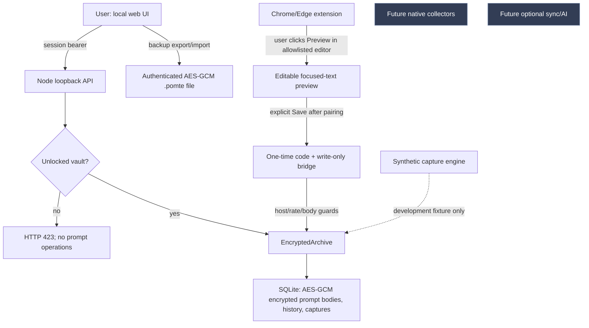

# v0.2 architecture — explicit user action first

> **Documentation scope (31 October 2026): Historical plan or implementation snapshot.** The original body is preserved for context. Its proposed stack, milestones and then-current feature claims are superseded by current guidance. [Core objective](CORE_OBJECTIVE.md) | [Documentation index](DOCUMENTATION_INDEX.md)

## Decision summary

We are keeping the local HTML/CSS/JS + Node + SQLite prototype to measure usability **before** migrating to a lower-overhead native shell. Production goal remains a signed **Tauri 2/Rust** desktop application using platform capture permission boundaries and OS-protected keys. v0.2 does not secretly bolt a keylogger onto the web vault. The immediate differentiator is trustworthy capture/reuse with provenance and a reversible, offline workflow.

## Component boundaries

1. **Data:** `packages/local-store/archive.ts` stores immutable captured source records separately from editable library entries. Library payload fields (`title`, `body`, `project`, `tags`, `notes`, `source`, `usage`) and revision history are individually sealed with AES-256-GCM under AAD containing item identity. Select searchable operational metadata (`kind`, `pinned`, row timestamps, deleted flag) is deliberately unencrypted; full-file encryption is a blocker for public production. v0.1 missing columns are migrated on first open.
2. **API/security:** `apps/local-web/server.ts` serves static UI and authenticated JSON from 127.0.0.1. The local UI token is ephemeral per process and transferred in the browser's URL **fragment**. Required bearer token + exact Host/Origin reduce web-origin exposure. Strict content limits and CSP apply. Any local malware, hostile privileged extension, exposed session link or OS-level process memory reader is outside this prototype's reliable defenses.
3. **Memory/lifecycle:** `apps/local-web/vault.ts` unlocks with scrypt, keeps cryptographic key in memory while authorized, and locks on 15 minutes of authenticated inactivity. Browser input events send a throttled lightweight status refresh when the user is **actually typing**, not a perpetual heartbeat. Lock revokes paired browser write capability and clears decrypted DOM fields/arrays where feasible; JavaScript GC/clipboard history are not securely erasable.
4. **Read path/search:** For common recent/pinned listings, SQLite returns only requested rows via indexed pagination. Filtered/search results are decrypted in memory, ranked with small bounded top-K (limit+offset) and discarded. `libraryFacets` caches normalized project/tag counts until mutation. The tradeoff favors no persistent plaintext FTS over sub-millisecond 50k-item search; design an encrypted/SQLCipher FTS option only after real workload measurements.
5. **Portable backup:** `apps/local-web/backup.ts` AES-256-GCM serializes a bounded snapshot (library/history/captured sources, including Trash), encrypts it with a separate passphrase and random per-file salt. Opening authenticates before parsing. `importSnapshot` validates, re-redacts and transactionally merges; duplicate IDs are skipped. No background file sync or remote data transfer.
6. **Browser helper:** Manifest V3 activeTab grants a user-clicked, focused-editor preview only on HTTPS allowlisted hosts. The helper never reads saved vault entries. Pairing uses a user-visible `psv2:port:random32` one-time code; extension gets a random write-only capability stored in `chrome.storage.session`, valid at most eight hours or until lock. Origin is `chrome-extension://[a-p]{32}`; the API only grants CORS for the two bridge POST routes, caps and rate-limits saves, and never accepts arbitrary sites. A compromised extension with its temporary token could still inject up to 15 records/min and content must be treated as untrusted.

## Resource design for low-memory PCs and Macs

- Runtime has **no third-party production npm dependencies**, no bundled AI model, no remote inference, no background capture loop, and no cloud synchronization process.
- Browser UI retrieves pages of 40. Search keeps at most `offset+limit` decrypted candidates (subject to 100-page and offset caps), instead of retaining every matching object. The optional extension has no background worker.
- We measure **Node process RSS only** in `scripts/bench-beta.ts`; browser process and OS-specific efficiency are unmeasured. The Node runtime is a development tradeoff and may not satisfy market-wide low-memory goals when both Node and a browser are active.
- **Future native choice:** Tauri 2 system WebView + small Rust backend with a bounded queue; launch on demand, keep background recorder disabled until user opted in, and avoid compulsory model runtimes. Use capability scoping per window and signed updates. Reference: https://tauri.app/security/capabilities/ and https://tauri.app/plugin/updater/ . Those docs describe platform capabilities, not evidence we've implemented them here.

## Proposed native boundary (not shipped)

| Port | Expected contract | Fail-closed rule |
| --- | --- | --- |
| `CapturePort` | Emit consented focused-editor snapshots with app/site, quality, privacy flags | Unknown site or protected/private state => no text |
| `NativePermissionPort` | Observe OS accessibility grant, revoked state, active input | No permission => stop immediately; visible pause state |
| `VaultPort` | OS keychain/DPAPI/Keychain + encrypted database with schema migration | No keys => locked; no silent plaintext fallback |
| `ShortcutPort` | User-configured global finder/paste, explicit focus target | No auto-submit, no typing into protected fields |
| `SyncPort` | Optional encrypted outbox/tombstone sync only after consent | No network until user enables; fail closed on auth errors |

## Unresolved architecture decisions (release-critical)

- AES-GCM per-row encryption vs SQLCipher full-file, WAL and temp-file leakage; audit on Windows/macOS and measure 10k/50k search. Do not expose a plaintext indexing sidecar without opt-in and clear threat model.
- DPAPI/macOS Keychain recovery, passphrase rotation, multiple devices, deterministic schema backup/upgrade rollback.
- Verified opt-in native editor adapters with evidence-quality semantics, site allowlists and private/protected exclusion tested at the *producer*, not solely regex redaction.
- Browser extension store distribution / clear permission explanation, threat modeling local write-only bridge, CSP and XSS assessments by an independent reviewer.
- A signed/notarized desktop release pipeline, crash diagnostics without contents, a clear opt-in update policy, and installer/uninstaller data retention choices.
