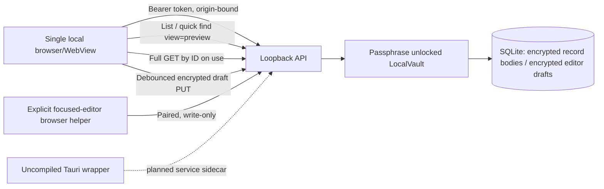

# promteSaver 0.4 architecture: local memory, bounded projection, safe recovery

The v0.3 architecture is retained: one local Node service, a loopback HTTP browser UI, a SQLite archive of individually authenticated AES-256-GCM encrypted record payloads, and an optional manually paired Chrome/Edge helper. The Tauri host is **source-only and uncompiled**. No cloud service, AI worker or system-wide collector has been activated.

## Storage boundary

- `library`, `library_history`, `records` store individually encrypted content. SQLite row names, types, timestamps, kind/pin metadata and file structure are **not fully encrypted**.
- Drafts reside in `metadata` as `editor-draft-v1:<UUID>` -> AEAD ciphertext with context including that full key name. Raw draft plaintext never goes in `sessionStorage`, a URL, or client localStorage; only the session capability is stored in sessionStorage. Browser DOM and JS strings contain plaintext *while unlocked* and are best-effort cleared on lock.
- Each new editor session uses a random v4 UUID. Up to **eight** independent drafts may be saved. Draft list is available only to an unlocked authenticated browser, and the UI only recovers by creating a new library item. An autosave does not modify committed history or constitute evidence of a submitted prompt.
- Drafts are **not part of encrypted portable snapshots** because they represent incomplete work and may contain secrets not yet redacted. A stopped-service whole-folder copy preserves them. Draft retention is user-managed (recover or discard); the eight-item limit avoids unbounded growth.
- The existing `keyinfo.json` wrapped key migration is unchanged. No new schema version is required because the drafts occupy already supported encrypted metadata rows.

## Response projection and correctness

- `GET /api/items` without `view` is backwards compatible and returns the full library page.
- `GET /api/items?view=preview` returns at most 1,600 characters of body (or 420 in low-memory mode) and at most 240 characters of notes for long items, tagging them with `preview:true`. Other metadata needed to render a page stays visible only in the **authenticated HTTP response**, not persisted plaintext.
- Client performs an authenticated `GET /api/items/:id` before operations needing untruncated content. An ETag represents the complete underlying item, not the projection. A subsequent changed item cannot be silently overwritten because update calls use `If-Match`.
- Encrypted search remains an O(n) SQLite decrypt-and-scan on a cache miss. Neither `view=preview` nor the new SQLite page-cache limit changes this worst-case complexity. A persistent blind index is explicitly **not shipped**, pending security/leakage review.

## CPU/memory and process-lifecycle decisions

- No dedicated worker, background scheduler, general telemetry, OS-wide hook, local AI model or speculative preloading. The local service is a single Node process, authenticated activity resets its idle lock, and status polling does not.
- Server asset contents are read once, page/quick-finder lists are paginated, and the browser creates a `DocumentFragment` for one append per refreshed page.
- Low-memory toggle: 20 cards, shorter previews, smaller query cache, SQLite cache page budget 1 MiB and file-backed temp sorting. Normal SQLite page-cache budget 2 MiB. A small cache is a limit, not a guarantee of total memory use.
- For a consumer desktop install, **Tauri + one system WebView** remains the chosen exploration path, but a bundled Node runtime consumes RAM and disk independently. Replacing Node with a native Rust archive/service is the long-term memory-leverage option and needs a deliberate migration, not a parallel untested implementation.

## Remaining P0 decisions

1. Compile and inspect real Tauri binaries on target OS/CPU architecture; signed MSI/NSIS/.app packages and OS lifecycle handling remain a verified gate.
2. Integrate OS-protected keys and full file/WAL encryption with compatibility/rollback testing, security review and threat modeling.
3. Run live browser-to-real-service UI tests without bypassing administrator restrictions; test native WebView2/WKWebView process trees, startup, suspend/resume, file dialogs and accessibility.
4. Profile cold searches and >10k realistic long records before choosing an indexed-search design. Evaluate information leakage of any blinded index.
5. Only then consider opt-in, per-source native capture and confirmed submission evidence. Cloud and AI are separate opt-in projects.

Architecture references: [Microsoft WebView2 performance](https://learn.microsoft.com/en-us/microsoft-edge/webview2/concepts/performance), [Microsoft WebView2 developer practices](https://learn.microsoft.com/en-us/microsoft-edge/webview2/concepts/developer-guide), [Tauri external binaries](https://v2.tauri.app/develop/sidecar/), [Playwright browser testing](https://playwright.dev/docs/browsers).
