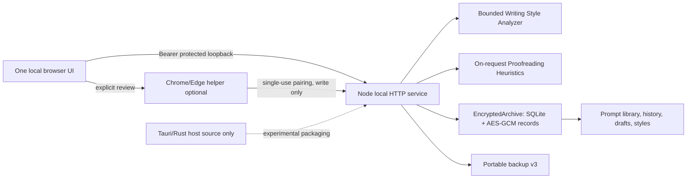

# Architecture — v0.6 local vault + Writing Studio

> **Documentation scope (31 October 2026): Historical plan or implementation snapshot.** The original body is preserved for context. Its proposed stack, milestones and then-current feature claims are superseded by current guidance. [Core objective](CORE_OBJECTIVE.md) | [Documentation index](DOCUMENTATION_INDEX.md)

## Executable components

The experimental desktop source packager now allowlists `packages/writing-style/` alongside the encrypted store and local HTTP app so compiled builds will have the required imports available. This confirms **source completeness only**, not that an installer runs.

There is **no outbound AI call**, background writing observer, external style training, native global overlay or cloud sync in this release. Writing Studio is an additional view of the same source-based local service.

## State & trust boundaries

**Unlocked browser:** stores decrypted writing in ephemeral DOM fields while viewed. The page clears text inputs, issue previews, lists, and generated instructions when the vault locks. OS clipboard, memory swap, browser history and user-initiated unencrypted JSON downloads are outside this control. A separate opt-in governs raw sample excerpts in the profile; toggling only export consent does **not** erase an existing saved profile's excerpts.

**HTTP:** `POST /api/styles/analyze` analyzes intentionally submitted samples; `GET /api/styles` returns summaries; `POST /api/styles`, `GET/PUT/DELETE /api/styles/:id` operate under vault bearer auth. `If-Match` is required for mutation to protect stale tabs. `POST /api/styles/:id/prompt` creates instructions locally for use with external AI tools; an optional per-call `includeExamples` sends stored excerpts and recurring phrases into the returned text, never to a model. `POST /api/writing/check` checks explicitly supplied text without persisting it. Requests are subject to strict byte/character limits. Lock invalidates access until unlock.

**Database:** `writing_styles(id TEXT PRIMARY KEY, payload BLOB)` stores a random identifier and encrypted profile, name, revision, timestamps. Ciphertext uses AES-256-GCM with contextual authenticated additional data. The outer SQLite file, WAL, existence, record counts, and opaque IDs can be observed. This is *not* SQLCipher or full-file encryption, and key-metadata/wrapped-key recovery boundaries from v0.4 still apply.

**Portable backup:** snapshot `version:3` includes `styles` with existing prompt items, histories, capture evidence and deletion tombstones. An encrypted portable backup is produced by the existing backup route; v1/v2 imported snapshots omit styles. A direct style JSON export is not encrypted—its warning and explicit sample-inclusion control are important.

**Proofreading:** TypeScript `proofreadWriting()` runs deterministic regex and length checks on text of at most 12,000 UTF-16 code units, producing at most 50 offsets+messages. It does not modify source input. The client requires a fresh text-position match before applying one replacement and discards remaining suggestions after a change. No dictionary download or remote API.

## Memory and availability architecture

- The Node service and one local browser/WebView retain the same v0.4 startup architecture; v0.6 introduces **no background runtime worker** or required AI inference model.
- Profile list contains only metadata summaries. Selecting one decrypts it explicitly, then lock clears associated rendered text.
- The writing analyzer builds temporary bounded arrays from user-submitted samples; repeated profiling is on demand rather than an always-on watcher.
- 16 stored profiles and 12,000-character proofread limit bound worst-case feature memory independently of archive size.
- Main library still searches by decrypt-and-scan with bounded previews and LRU query ID cache; v0.4 resource numbers remain the relevant baseline for whole-backend evaluations. The writing microbenchmark measures warm synthetic CPU cost, **not installed Windows/macOS app memory**.

## What is deliberately absent

- Personal identity verification from writing style: not scientifically supportable from these heuristics.
- Covert recording, arbitrary screen reading, keyboard interception, unsolicited AI processing, auto-apply overlays.
- Guaranteed removal of personal information via regular-expression redaction: the user must review excerpts and exports.
- Automatic rewriting: generated instructions can be pasted into an AI tool, but this app does not obtain the rewritten result or claim AI-equivalent proofreading.
- Signed, compiled desktop app: the Tauri source is a separate feasibility asset and still needs native build and lifecycle tests.
