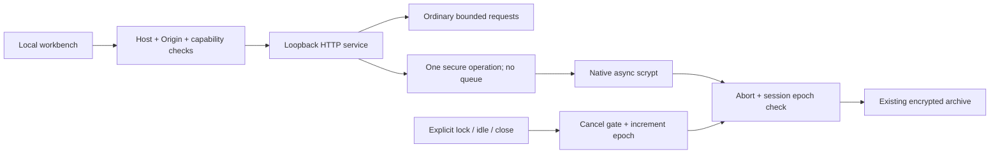

# Architecture decision: bounded responsive local work (v0.8)

Date: 2026-10-23. Status: implemented and verified in Node compatibility tests; native host still experimental.

## Problem

The v0.7 HTTP service invoked synchronous scrypt while processing setup, unlock, passphrase and portable-backup requests. During that CPU-intensive call the event loop could not answer status or lock requests. Simply moving every call off-thread without coordination would instead allow several memory-intensive jobs to overlap and introduce lock/unlock races.

## Decision

Keep the existing encryption formats and work factors. Use Node's asynchronous native scrypt through a narrow `deriveKeyAsync` module and a single per-service `WorkGate`. There is no new worker process, scheduler daemon, external service or production package.

This removes KDF blocking of the event loop, not its CPU/memory cost. SQLite operations, text scans, JSON parsing and backup serialization still execute synchronously and remain bounded rather than magically nonblocking.

## Invariants

1. Only one expensive HTTP operation occupies the gate, including reading its bounded body. Concurrent attempts receive HTTP 503 / `SECURE_OPERATION_BUSY` / `Retry-After: 1`. They are not queued.
2. Lock increments a vault generation, revokes helper credentials and marks pending secure work cancelled. The native KDF cannot be interrupted; the gate remains occupied until it returns and temporary buffers are cleared.
3. Async vault operations recheck generation and cancellation before committing. Setup/unlock must not open a late session; passphrase changes must not replace metadata after cancellation.
4. Every HTTP body read revalidates the generation captured before the read. A slow authorized write from before lock cannot resume into a later unlock session. Helper callers retain their 401-expired-session behavior.
5. Metadata remains atomic. Legacy metadata is upgraded only after database authentication. Existing backup magic, snapshot v3 and key-envelope v2 formats remain unchanged.
6. Backup export gathers plaintext only after derivation and a session check. Cancelled import never applies a decrypted snapshot. The 12 MiB portable limit remains; streaming large backups is separate work.
7. Service shutdown waits for the active secure operation before releasing its single-vault lease. A client disconnect cancels its secure operation.
8. UI generation guards reject late auth/network results. Setup/unlock support visible cancellation; passphrase and backup work is cancelled through locking, closing or shutdown. We do not claim every modal has a separate cancel-the-native-KDF button.

## On-demand diagnostics

An authenticated, unlocked `GET /api/diagnostics` returns an allowlisted snapshot of application/runtime versions, selected resource mode, Node RSS/heap, aggregate selected vault-file sizes and disclosed limitations. It does not read prompt records, gather paths, enumerate user files or contact a network endpoint. Like `/api/status`, it does not extend idle time. UI state and download Blob URLs are discarded on lock; previously downloaded files cannot be recalled.

The panel is not a background sampler. Low-memory advice is heuristic (host reports <=8 GiB) and does not override user preferences. Container or OS-reported memory is not a guaranteed available-to-this-app figure.

## Ranking

The candidate collector is now a bounded max-heap, with the worst retained result at its root. Comparator behavior (score, pinning, timestamps, stable ID tie-break) is unchanged. Insert/replace costs O(log K), where K is the requested offset plus page size; final ordering costs O(K log K). RAM remains O(K) candidate metadata. Record decryption still scans O(N); no persistent plaintext search index was introduced.

The change targets deep pages and removes repeated sorted-array shifts. Full search speed and memory claims require measured results, not just asymptotic reasoning.

## Desktop preparation

Staging resolves versions from root metadata; verifies a v2 resource manifest after copying; streams executable hashing; rejects path traversal, symlinks, accidental vault artifacts and unreviewed JSON in selected source roots. Hashes catch inconsistency relative to a trusted manifest, **not malicious replacement of both files and manifest**. They are not code signatures or an installed runtime verifier.

The manually dispatched workflow checks Node source, resolves the still-missing native lockfile explicitly, stages resources and attempts Cargo/Tauri builds. It has read-only repository permission and uploads workflow artifacts, never public Releases. Job success has not been observed here. Reviewed transitive dependencies, pinned action/toolchain identities, independent security review and signed distribution remain separate gates.

## References consulted

- Node crypto, asynchronous scrypt and threadpool behavior: https://nodejs.org/api/crypto.html
- Tauri external executable layout: https://v2.tauri.app/develop/sidecar/
- Tauri native build workflows: https://v2.tauri.app/distribute/pipelines/github/
- Pinned preview CLI release: https://v2.tauri.app/release/tauri-cli/v2.11.2/
