# Architecture - Windows preview, consent-scoped capture and explicit AI

> **Documentation scope (31 October 2026): Current reference.** Use the current objective for priorities and the readiness/test records for acceptance; dated results retain their original scope. [Core objective](CORE_OBJECTIVE.md) | [Documentation index](DOCUMENTATION_INDEX.md)

## Product and component map

The architecture serves [capture → local memory → review → reuse](CORE_OBJECTIVE.md). Current path: approved foreground Windows field → native producer → authenticated private service → encrypted immutable snapshot plus editable copy → native history/search/copy. Optional browser producers enter through the write-only bridge. Explicit vault-editor recall and separately previewed Groq requests support reuse; there is no daily AI worker, global suggestion overlay, account service or sync backend.

Source approval is keyed by executable name with foreground checks, not publisher identity. Passive browser saves do not renew idle time; authenticated native requests can. Status/diagnostic reads do not renew it. Lock revokes consent and invalidates pending work. A slow synchronous UIA provider and the unbounded ValuePattern getter remain unresolved responsiveness/resource risks.

Original design date: 2026-10-23. Source reviewed through the 27 October ValuePattern change; documentation aligned 31 October 2026. The current Windows UI is WinForms with a private Node sidecar and a separate DPAPI-protected vault. The older passphrase source/browser vault is not migrated. Tauri remains experimental. Browser capture is optional and separately approved; real Codex session capture remains disabled pending private/protected exclusions. Latest-source compilation and an older bundled setup are separate evidence; no new final setup was produced after the recorded EXE file lock.

## Windows approved-app focused-field source — 26 October 2026

`FocusedFieldCapture.cs` starts only after the unlocked user selects a running app and accepts a per-app dialog in `Program.cs`. The active source set lives only in that unlocked session. A low-level keyboard hook sees event occurrence, not key values; UI Automation focus changes and TextPattern/ValuePattern changes also schedule a 1.3-second settle. Immediately before reading, the observer rechecks the same foreground window/process and focused-field ancestry, and requires an enabled, onscreen, non-password Edit/Document control without a sensitive field name. ValuePattern or TextPattern read-only metadata must establish that the field is writable; an explicit read-only report or unknown editability excludes it. TextPattern is read with a 50,001-character limit; a writable ValuePattern-only control is a fallback when TextPattern is absent or fails, and the resulting text is rejected above 50,000 characters. ValuePattern does not offer a length-limited getter, so its provider can allocate a large value before that rejection. On focus binding, existing field text is held as an in-memory comparison baseline and is not saved merely because the user focused it. Browser, system authentication and password-manager processes are excluded at the native producer and again at the service contract. There is no clipboard polling, screen/audio capture or background inference. A text change can save non-prompt content; no send/delivery event is inferred. A UIA provider that omits both readable patterns, editability metadata or change events may miss text. Some synchronous UIA provider calls still run on the WinForms UI thread and require bounded-worker design and real-app endurance checks before release.

The private `/api/capture/field/consent` endpoint accepts explicit current-session consent for up to eight executable **names**; `/api/capture/field/snapshot` requires the matching approved source and exact bounded payload. This is not a signed executable identity or unique process ID. `fieldSnapshot` fixes `deviceId: windows-focused-field`, `classification: unknown`, `sourceMethod: editor_snapshot` and `quality: draft_snapshot`; contract validation rejects that classification from any other source shape. The service caps writes, deduplicates unchanged text, and revokes approval on Pause all/lock. `saveFieldCapture` writes immutable encrypted evidence and a separate editable Desktop inbox copy. The native prompt list refreshes after a successful save when no search/review is active. Live temporary-vault Windows pilots captured typing and paste in a synthetic WPF TextBox, excluded PasswordBox and read-only TextBox controls, confirmed Pause all stopped later saves, and confirmed focus of pre-existing text alone did not save it. This does not certify other app frameworks, actual voice dictation, browser pages, send detection or an installed public release.

## Prompt-first native window and per-user setup prototype — 26 October 2026

`Program.cs` now presents the saved list and selected text as the main desktop view. Each list row shows an excerpt, app/site and local time; search, copy, source approval, Pause and Lock are visible. Browser pairing, startup and explicit offline wording review are in a collapsible **More options** panel. A successful Notepad save reloads the first page when the user is not searching or reviewing. The low-level hook caches the foreground process gate for repeated keys in the same window, then revalidates process and focused editor before text access; key values remain unread and unretained.

`build-setup.ps1` builds the bundled WinForms preview, verifies its runtime manifest, compiles a small removal helper, and embeds only selected portable files in an unsigned `promteSaver-Setup.exe`. `Installer.cs` validates archive paths, duplicate names and size bounds before extraction to a fresh staging folder; a test mode is restricted to a direct child of `%TEMP%`. The intended normal path is `%LOCALAPPDATA%\Programs\promteSaver`, separate from the DPAPI-protected vault. The setup code registers a per-user shortcut and uninstall entry. Removal reads its own file manifest and deletes only listed program files; it deliberately preserves vault data and unknown added files. The normal setup UI, shortcut/registry writes and removal path have not passed a real user install test. Neither the embedded payload nor the manifest is a code signature; signing, license and clean-device review remain open.

## Windows Notepad keyboard-triggered source — 25 October 2026

`NotepadKeyboardCapture.cs` installs a low-level Windows keyboard hook only after the unlocked user checks the Notepad source and clicks Start. Keydown merely schedules a 1.3-second timer while the foreground process name is `Notepad`; the hook never reads or stores key values. On the timer, the native host checks the same foreground window, focused-element ancestry, enabled/on-screen/non-password state, `Document` control type and the observed `Text editor` name before requesting a bounded UI Automation `TextPattern` value. Empty or over-50,000-character drafts are rejected. Unknown controls and other processes are not read. This is a source-specific editor snapshot, not a submit detector or general keylogger.

`keyboard-capture.ts` rejects malformed IDs, timestamps, excess text and unknown payload fields, then stamps fixed `notepad.exe` provenance and `draft_snapshot` quality. The desktop-only `/api/capture/keyboard/consent` gate is off by default and is cleared on pause/lock; `/api/capture/keyboard/snapshot` requires the private unlocked session, deduplicates unchanged text, and limits writes to 15 per minute. `saveKeyboardCapture` stores immutable encrypted evidence and a separate editable Desktop inbox copy. The native app exposes source status and a content-free gap code. A single Windows 11 Notepad typing/pause pilot passed in a temporary vault. This does not establish other app, browser, protected-field, long-session or installer acceptance.

## Native preview and source gate

`apps/desktop/windows-host/Program.cs` owns one child `apps/desktop/sidecar.ts` process, connects through a private local handshake, and provides a native one-click vault gate/Capture window, recent evidence, explicit offline wording review, one-host browser pairing, visible tray pause/lock/quit, and source status. The Windows CurrentUser DPAPI blob is held in `desktop-credential.bin` beside the new vault data. Missing or tampered credentials fail closed; neither old-vault migration nor cross-account recovery is implemented. The build script stages allowlisted source, the supported Node 24 runtime, full Node license and unpacked browser helper in a portable folder. The runtime manifest detects accidental file changes against its matching manifest; it is not a signature or a defense when both are replaced. Vault ownership remains single-service, and quitting stops the child. A compiled EXE temporary-vault self-test and extracted-ZIP self-test passed; installer, clean-device, long-running tray, macOS and whole-app resource acceptance did not.

The optional **Start with Windows** checkbox writes one per-user `HKCU\Software\Microsoft\Windows\CurrentVersion\Run` value for the current EXE path. It is off by default; disabling removes that value only if it still points to this EXE. Login launch opens the visible locked app and does not restore browser pairing or source approval. Its registry toggle and actual login behavior remain untested.

`apps/desktop/codex-source.ts` is an event-driven, bounded JSONL producer. Construction does not read files; explicit start baselines existing files at EOF. It accepts only `event_msg` entries with a `user_message` payload, prevents path escape/symlink traversal, and reports truncation/rotation/backlog gaps. `apps/local-web/native-capture.ts` binds an injected test source to the unlocked session, checks generation before storing, and uses `saveNativeCapture` for encrypted immutable `draft_snapshot` evidence plus a linked editable copy. Lock/pause invalidate the producer and in-flight writes. These behaviors are covered on synthetic session files and do not certify the undocumented real Codex format. Because real private/protected session exclusion is not verified, the public Windows preview must not read the user's real `~/.codex/sessions` directory. The product's broad cross-application capture goal remains unimplemented.

`GET /api/capture/status` is an authorized observational read that does not renew idle time. `POST /api/capture/pause` revokes current browser pairing and any internal test source. `GET /api/capture/review` returns at most 20 recent immutable saved snapshots with bounded local `proofreadWriting` suggestions on explicit request, preserving those snapshots. Capture safety rules may redact obvious secrets before persistence; a snapshot is not guaranteed byte-for-byte raw input. This is not an automatic AI rewrite or a background job.

## Data flow

```mermaid
flowchart LR
  Composer[Approved AI-site composer] -->|trusted Send / Enter| Recorder[Isolated content script]
  Composer -->|900 ms pause, opt-in| Hints[Local bounded hints]
  Recorder --> Worker[MV3 event worker]
  Worker -->|write-only session / loopback| HTTP[Authenticated local service]
  HTTP --> Tx[Transaction]
  Tx --> Evidence[Immutable redacted snapshot]
  Tx --> Library[Editable Browser inbox copy]
  TaskDraft[Vault editor draft] -->|explicit Find related| Recall[Local keyword recall]
  Library --> Recall
  Recall -->|chosen full source, reviewed| TaskDraft
  Library --> Preview[Explicit local AI preview]
  Profile[User writing preferences, no samples] --> Preview
  Preview -->|fresh approval digest + consent| Runner[One bounded Groq request]
  Runner -->|fixed HTTPS endpoint| Groq[External Groq provider]
  Groq --> Review[Side-by-side result review]
  Review -->|explicit Save only| Draft[Separate AI-labelled library item]
```

## Trust boundaries

1. **Website content is untrusted data.** Static per-host composer selectors, top-frame-only injection, actual trusted events, visible/enabled editor checks and recognized private/protected exclusions. No script commands in prompts are executed. Unknown editors fail closed. Site private modes and editor layouts are not fully detectable; real-site tests remain required.
2. **Extension is write-only.** A local popup asks for per-host permission. A separate unlocked-vault pairing authorizes the host set. The worker derives host from the browser sender, not the message. No incognito or subframe capture. Only the popup can enable sites; the content panel can pause its site.
3. **Loopback service owns data.** Exact extension-origin token, freshness/size/host/signal checks and post-body session validation. Tokens expire after eight hours, revoke on lock and are never read capabilities. No queue. The idle lock is not disabled or renewed by passive companion use.
4. **Captured evidence is immutable.** The observed snapshot is classified draft_snapshot because Send/Enter is not server acknowledgement. The editable copy has an encrypted captureId link. Transactional writes, tombstones and backup validation prevent a normal restore from resurrecting deleted capture-linked data. Unlinked user-created duplicates are independent records and are not inferred/deleted by text similarity.
5. **AI is an explicit external transfer.** Endpoint fixed to Groq chat completions, redirects rejected, key encrypted at rest in metadata, no extension key access. Requests contain redacted source plus optional profile preferences/numeric tendencies, never stored examples. Each request requires consent and a digest matching its local preview, current model/settings and session. Provider errors are not echoed verbatim.
6. **Output is untrusted draft text.** No tools, browser, command execution, auto-insertion or original overwrite. User reviews and may save a separate item. Prompt-injection instructions cannot grant capabilities the adapter does not expose, but linguistic accuracy/compliance still require evaluation.

## Bounds and resource decisions

- Hints: event-driven, 900 ms debounce, <=12k characters, three short messages, no polling/MutationObserver/background model.
- Capture: <=50k characters, UUIDv4 IDs, timestamps within five minutes, 1.5 s content-event duplicate suppression. Worker max two pending requests, four-second deadline, <=8 KiB response; backend max 15 writes/minute. No automatic retries or offline plaintext queue.
- AI: one active request, max six/minute, 12 s deadline, <=12k source chars, <=20k style chars, <=96k provider bytes, <=32k returned chars, max 1200 completion tokens. No production SDK dependency.
- Lock/settings changes abort provider request and invalidate stale output. Native work or bytes already received by a remote provider cannot be undone. JavaScript strings/OS memory are not guaranteed zeroized.
- Existing bounded pagination, preview hydration, caches and async password work retained. New searches still decrypt/scan the archive. No overall memory-reduction claim.
- Explicit recall accepts at most 6,000 characters from the vault editor, scans decrypted saved entries only while unlocked, and returns at most five source previews. A selected source is fetched in full and its ETag rechecked before it can be added to the unsaved draft. It never grants the browser companion read access or runs a model; relevance is keyword overlap, not learned preference inference.

## Reviewed source extraction — local increment, 24 October 2026

The assistant now offers two separate actions for a saved library item. Understanding returns a structured task, exact source constraint quotes and unknowns. The user reviews that output before extraction, which returns up to five exact complete sentence/line quotes with title and review reason. Both requests use the same redacted outgoing-message preview, fresh consent, fixed provider endpoint and bounded single-request runner. Source ID and current ETag bind previews and saves; edits or deletion during provider work reject the result. The output must have the expected JSON shape and a normal `stop` completion reason. No model output executes as code or saves automatically.

A selected quote is stored as an independent editable template with chosen task/project/personal scope. Its encrypted notes record source item ID, revision, quote range and source hash, but there is no structured versioned derivation table. Source deletion does not cascade to independent copies. Task quotes are excluded from automatic recall because the current query has no stable task identity; project quotes require an exact selected project; personal quotes may cross projects. Users can still find their templates manually in the library. Conservative quote boundaries block simple missing-negation substrings but cannot establish meaning across paragraphs. No inferred personal preference or repeated-human-evidence claim is made. The stored source-extract tag also does not assert that a direct API save came from a model.

## Related-result feedback and gap receipts — local increment, 24 October 2026

Optional `worked`, `not-useful` or `hidden` feedback lives inside each encrypted library payload with the exact content revision and timestamp. It is included in portable snapshots, reset when the item content changes and retained on the previous encrypted history revision. Only explicit `hidden` feedback suppresses local related results; the other choices do not silently alter ranking. Related results show local keyword overlap and source/project/date, offer exact clipboard wording or an editable draft copy, and copy a source project into the draft only on a user click. They do not infer a missing instruction or claim model confidence.

The capture inbox displays a quality/source/date/delete receipt from existing record fields. The browser worker separately keeps at most 20 session-only `{host, reason, at}` save-gap entries in trusted extension storage; reasons come from a fixed allowlist and concurrent writes are serialized. It never stores failed prompt text for retry. The popup can show or clear these entries. Unknown editor gaps that never reach the worker cannot appear, and an unconfirmed response cannot establish whether a remote write happened.

## Storage and compatibility

Key-envelope v2 unchanged. Groq configuration is an AES-256-GCM metadata payload with row-bound AAD and omitted from portable backups; full vault copies retain encrypted configuration. Removing the key is not provider revocation or physical erasure.

Snapshots with linked browser captures use v4; otherwise v3. Import accepts v1-v4. v4 validates unique capture links and matching histories, preserves link metadata and applies incoming tombstones to evidence plus existing linked copies in one bounded library scan. Rolling back code against a v0.9-modified vault is not supported; restore a pre-upgrade copy instead.

## Modules

- `apps/local-web/ai.ts`: transformations, redaction, bounded/cancellable provider transport.
- `apps/desktop/windows-host/{Program.cs,build-preview.ps1}`: native Windows preview and explicit portable staging.
- `apps/desktop/codex-source.ts`, `apps/local-web/native-capture.ts`: injected test transcript producer and session gate; public real-directory collection disabled.
- `apps/local-web/browser-capture.ts`: host/session consent validation and evidence construction.
- `apps/local-web/server.ts`: authorization, preview digest and new APIs.
- `packages/local-store/ai-settings.ts`: strict encrypted-setting schema.
- `packages/local-store/archive.ts`: encrypted settings, capture transaction, deletion and snapshot links.
- `apps/browser-helper/{background,editor-core,recorder,popup}.js`: permissions, producer and user controls.
- `apps/local-web/public/assistant.{js,css}`: reviewed source/result interaction and lock cleanup.

## Important limits

This is not a global OS recorder, semantic memory model, automatic AI processing pipeline, local LLM, cloud sync service or verified installed extension. A compiled portable native preview is not an installed or signed release. Real-site content scripts can encounter changed selectors, nested frames, IME, temporary-mode variants and unusual keyboard behavior. Every claimed supported environment needs an explicit pilot test rather than a broad marketing claim.

## Capture reliability increment — 24 October 2026

Manual preview injects the same isolated `editor-core.js` used by the recorder, then invokes its focused-editor reader. Private/temporary/hidden pages and protected/inert/disabled fields are rejected before reading text. The returned host must match the initially approved tab host. Single-line inputs are excluded. Known private markers are best-effort checks, not universal detection of confidential site modes.

The worker checks actual optional host permission as well as persisted site choice and vault pairing. Site updates serialize their storage read/modify/write and script registration across hosts; a newer site operation invalidates an older one immediately. Failed registration persists a disabled choice. An authorization epoch and active AbortControllers invalidate pending work when site/session changes are observed; capture also rechecks the pairing token, port, expiry and host scope after async reads. Browser event delivery and a remote request already received cannot be undone. A paused worker never queues text for later.

The producer cancels hint timers when focus moves away, refreshes state after page restoration/visibility changes, tracks composition, rejects ambiguous composers, and confines form-associated Send buttons to that form. State-request and UI generations discard out-of-order state and old acknowledgements. These changes preserve synchronous snapshotting before page send handlers and conservative `draft_snapshot` evidence. No page method is patched and no polling or mutation observer is added.

Recall query tokens now retain Unicode marks along with letters/numbers. This repairs Telugu/Hindi vowel-sign fragmentation and decomposed-accent matching without changing storage, ranking weights, result limits or introducing a plaintext index. It does not add stemming, translation or semantic retrieval.

## Primary integration references (consulted 2026-10-23; Chrome scripting/permissions rechecked 2026-10-24)

- Groq models: https://console.groq.com/docs/models
- Groq request schema: https://console.groq.com/docs/api-reference
- Chrome optional/script permissions: https://developer.chrome.com/docs/extensions/reference/api/scripting
- Chrome session/trusted-context storage: https://developer.chrome.com/docs/extensions/reference/api/storage
- Extension cross-origin requests: https://developer.chrome.com/docs/extensions/develop/concepts/network-requests
- Playwright extension testing: https://playwright.dev/python/docs/chrome-extensions

References justify API design, not proof of successful real-site/provider/native execution. No competitor code was copied and no new production package was added.
