# Architecture - consent-scoped browser capture and explicit AI

Date: 2026-10-23. Status: implemented source, tested in the scopes stated below. The local web runtime remains the working host; native Tauri remains experimental source.

## Data flow

```mermaid
flowchart LR
  Composer[Approved AI-site composer] -->|trusted Send / Enter| Recorder[Isolated content script]
  Composer -->|900 ms pause, opt-in| Hints[Local bounded hints]
  Recorder --> Worker[MV3 event worker]
  Worker -->|write-only session / loopback| HTTP[Authenticated local service]
  HTTP --> Tx[Transaction]
  Tx --> Evidence[Immutable redacted snapshot]
  Tx --> Library[Editable Browser inbox copy]
  TaskDraft[Vault editor draft] -->|explicit Find related| Recall[Local keyword recall]
  Library --> Recall
  Recall -->|chosen full source, reviewed| TaskDraft
  Library --> Preview[Explicit local AI preview]
  Profile[User writing preferences, no samples] --> Preview
  Preview -->|fresh approval digest + consent| Runner[One bounded Groq request]
  Runner -->|fixed HTTPS endpoint| Groq[External Groq provider]
  Groq --> Review[Side-by-side result review]
  Review -->|explicit Save only| Draft[Separate AI-labelled library item]
```

## Trust boundaries

1. **Website content is untrusted data.** Static per-host composer selectors, top-frame-only injection, actual trusted events, visible/enabled editor checks and recognized private/protected exclusions. No script commands in prompts are executed. Unknown editors fail closed. Site private modes and editor layouts are not fully detectable; real-site tests remain required.
2. **Extension is write-only.** A local popup asks for per-host permission. A separate unlocked-vault pairing authorizes the host set. The worker derives host from the browser sender, not the message. No incognito or subframe capture. Only the popup can enable sites; the content panel can pause its site.
3. **Loopback service owns data.** Exact extension-origin token, freshness/size/host/signal checks and post-body session validation. Tokens expire after eight hours, revoke on lock and are never read capabilities. No queue. The idle lock is not disabled or renewed by passive companion use.
4. **Captured evidence is immutable.** The observed snapshot is classified draft_snapshot because Send/Enter is not server acknowledgement. The editable copy has an encrypted captureId link. Transactional writes, tombstones and backup validation prevent a normal restore from resurrecting deleted capture-linked data. Unlinked user-created duplicates are independent records and are not inferred/deleted by text similarity.
5. **AI is an explicit external transfer.** Endpoint fixed to Groq chat completions, redirects rejected, key encrypted at rest in metadata, no extension key access. Requests contain redacted source plus optional profile preferences/numeric tendencies, never stored examples. Each request requires consent and a digest matching its local preview, current model/settings and session. Provider errors are not echoed verbatim.
6. **Output is untrusted draft text.** No tools, browser, command execution, auto-insertion or original overwrite. User reviews and may save a separate item. Prompt-injection instructions cannot grant capabilities the adapter does not expose, but linguistic accuracy/compliance still require evaluation.

## Bounds and resource decisions

- Hints: event-driven, 900 ms debounce, <=12k characters, three short messages, no polling/MutationObserver/background model.
- Capture: <=50k characters, UUIDv4 IDs, timestamps within five minutes, 1.5 s content-event duplicate suppression. Worker max two pending requests, four-second deadline, <=8 KiB response; backend max 15 writes/minute. No automatic retries or offline plaintext queue.
- AI: one active request, max six/minute, 12 s deadline, <=12k source chars, <=20k style chars, <=96k provider bytes, <=32k returned chars, max 1200 completion tokens. No production SDK dependency.
- Lock/settings changes abort provider request and invalidate stale output. Native work or bytes already received by a remote provider cannot be undone. JavaScript strings/OS memory are not guaranteed zeroized.
- Existing bounded pagination, preview hydration, caches and async password work retained. New searches still decrypt/scan the archive. No overall memory-reduction claim.
- Explicit recall accepts at most 6,000 characters from the vault editor, scans decrypted saved entries only while unlocked, and returns at most five source previews. A selected source is fetched in full and its ETag rechecked before it can be added to the unsaved draft. It never grants the browser companion read access or runs a model; relevance is keyword overlap, not learned preference inference.

## Storage and compatibility

Key-envelope v2 unchanged. Groq configuration is an AES-256-GCM metadata payload with row-bound AAD and omitted from portable backups; full vault copies retain encrypted configuration. Removing the key is not provider revocation or physical erasure.

Snapshots with linked browser captures use v4; otherwise v3. Import accepts v1-v4. v4 validates unique capture links and matching histories, preserves link metadata and applies incoming tombstones to evidence plus existing linked copies in one bounded library scan. Rolling back code against a v0.9-modified vault is not supported; restore a pre-upgrade copy instead.

## Modules

- `apps/local-web/ai.ts`: transformations, redaction, bounded/cancellable provider transport.
- `apps/local-web/browser-capture.ts`: host/session consent validation and evidence construction.
- `apps/local-web/server.ts`: authorization, preview digest and new APIs.
- `packages/local-store/ai-settings.ts`: strict encrypted-setting schema.
- `packages/local-store/archive.ts`: encrypted settings, capture transaction, deletion and snapshot links.
- `apps/browser-helper/{background,editor-core,recorder,popup}.js`: permissions, producer and user controls.
- `apps/local-web/public/assistant.{js,css}`: reviewed source/result interaction and lock cleanup.

## Important limits

This is not a global OS recorder, semantic memory model, automatic AI processing pipeline, local LLM, cloud sync service or verified installed extension. A loopback app is not a native release. Real-site content scripts can encounter changed selectors, nested frames, IME, temporary-mode variants and unusual keyboard behavior. Every claimed supported environment needs an explicit pilot test rather than a broad marketing claim.

## Primary integration references (consulted 2026-10-23)

- Groq models: https://console.groq.com/docs/models
- Groq request schema: https://console.groq.com/docs/api-reference
- Chrome optional/script permissions: https://developer.chrome.com/docs/extensions/reference/api/scripting
- Chrome session/trusted-context storage: https://developer.chrome.com/docs/extensions/reference/api/storage
- Extension cross-origin requests: https://developer.chrome.com/docs/extensions/develop/concepts/network-requests
- Playwright extension testing: https://playwright.dev/python/docs/chrome-extensions

References justify API design, not proof of successful real-site/provider/native execution. No competitor code was copied and no new production package was added.
