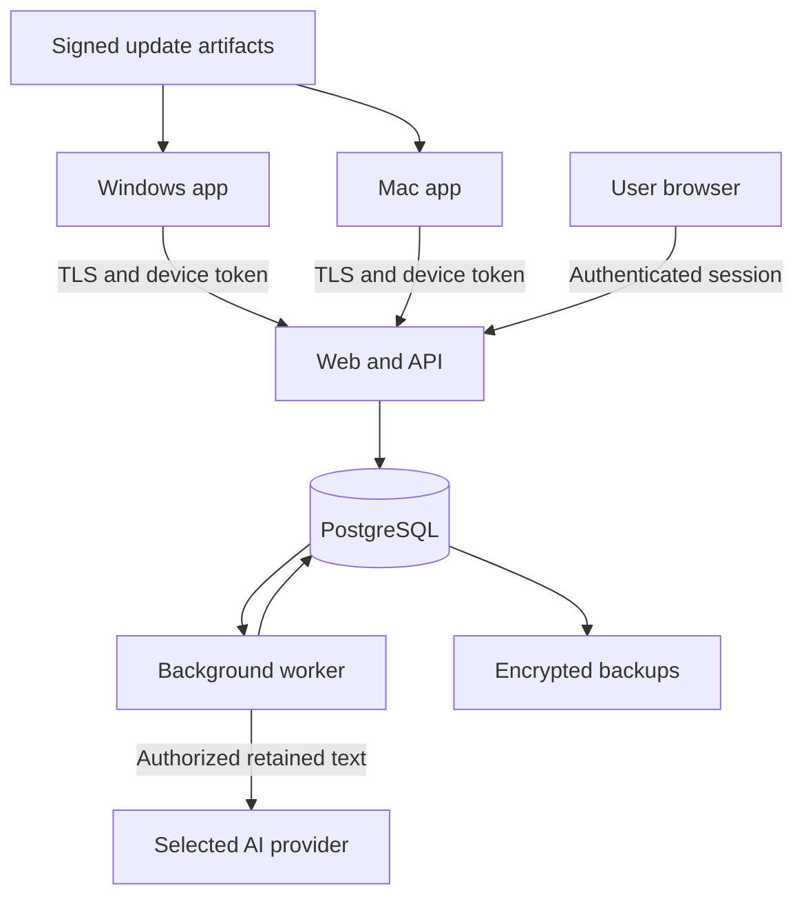

# Infrastructure and operations plan

Status: proposed, 19 October 2026. No infrastructure is provisioned. Vendor names, regions, prices, production domains, and credentials are intentionally unselected.

## Deployment shape

Start with three server components: web/API, background worker, and PostgreSQL. Both application processes share typed contracts but run independently. A slow or unavailable model must not block ingestion. Keep capture, the encrypted archive, the upload queue, and cached reuse inside the desktop app.

The diagram is logical: queue polling and database access details are implementation choices, not a database-triggered execution claim.

## Environments

| Environment | Components | Data and exposure |
| --- | --- | --- |
| M0 local harness | Collector and encrypted local store | Synthetic text only; no cloud dependency |
| Development | Desktop app, local web/API, worker, local PostgreSQL | Synthetic fixtures; services bound to development interfaces |
| Staging | Separate web/API, worker, database, identity configuration | Synthetic or explicitly selected test data; separate secrets |
| Personal pilot | Small production deployment after M2 gates | User's permitted prompts; visible sync settings and retention |
| Wider beta | Same logical services with measured capacity | Tenant isolation, device revocation, restore drills, compatibility evidence |

Docker Compose is a proposed development convenience, not a prerequisite for M0 or a deployed artifact. Production can use managed PostgreSQL and a small app/worker host. Do not add Kubernetes, Redis, or a separate vector service before measurements justify them.

## Desktop operation

- Run in the signed-in user's session, with tray/menu-bar controls and optional launch at login. Do not run the recorder as a hidden privileged system service.
- Use one collector owner per desktop login to prevent duplicate capture. Detect a second instance and connect its UI to the existing process or exit cleanly.
- Store app data under the platform's application-data directory, never in the Git checkout. Keys and device tokens belong in OS-protected storage.
- Keep local capture policy, encryption status, free-space status, pending count, oldest pending age, and last successful sync visible.
- On disk-full, locked key storage, or invalid encryption state, stop persistence and show a recoverable status. Never switch to an unencrypted file.
- Closing the window leaves an enabled collector running; explicit Quit stops it. On logout/screen lock, close active segments and obey the defined capture policy.

## Service responsibilities

Web/API: account session, device enrolment/revocation, batch ingestion, sync cursors, archive/search, templates, exports, deletion, and policy changes.

Worker: claim versioned jobs with leases, validate eligible source revisions, run understanding/generalization, index results, and handle deletion/recomputation. Expired leases can be retried; writes are idempotent. Deleted or superseded sources cannot be reintroduced by an already-running job.

PostgreSQL: authenticated ownership, append-oriented source records, template versions, durable job intents, device states, sync changes, and deletion metadata. Use database-level ownership policies where practical in addition to API authorization. Never trust the caller to supply an authoritative account ID.

Object storage is optional for later exports or large attachments. Initially, text records can remain in PostgreSQL. Update artifacts can use separate release hosting with signature verification.

## Secrets and identity

- Use a maintained identity/session system rather than implementing password cryptography.
- Desktop signs in through the system browser with a verified return/pairing flow. Tokens are device-scoped, independently revocable, and not embedded in downloads.
- Separate app database credentials, worker credentials, AI provider keys, session secrets, and update-signing keys. Production and staging never share these values.
- Keep secrets outside Git and exclude them from logs, traces, exports, and support bundles. Document variable names in a future `.env.example` without values.
- Prefer short-lived access tokens with a refresh/revocation design. Offline revocation takes effect when the device reconnects; document that limit.
- AI processing sends eligible text to the configured provider. Provider selection must include the intended retention and data handling settings. This cloud mode is not server-blind E2EE.

## Sync and database changes

The detailed protocol is in `TECHNICAL_DESIGN.md`. Critical operations are a local transaction plus outbox, per-item server acknowledgments, reconnect handshake before upload, idempotent retries, optimistic template versions, and deletion/account-generation barriers.

Use a versioned protocol. An older app must not silently send payloads under a changed retention or ownership policy. Server migrations should remain compatible with at least the supported client upgrade window. A client that is too old must retain its queue and show an update requirement.

Apply schema changes through versioned migrations, never ad hoc production edits. Test local encryption migrations with a recoverable encrypted backup. Test server migrations against representative synthetic history and deletion metadata.

## Backups and deletion

Proposed pilot targets: database backup at least daily, recovery point within 24 hours, and recovery within one working day. These are untested objectives, not service guarantees. Select an actual backup schedule, retention window, and restore procedure before the pilot.

Encrypt backups and restrict access independently from the application account. Run a restore drill into an isolated environment. Apply deletion metadata before restored data becomes searchable. Publish the backup expiry window rather than claiming immediate physical erasure from all backups.

Deleting a source must invalidate associated embeddings, search documents, caches, and derived content. Templates with other supporting sources are recomputed or suppressed. Disconnected devices apply deletion on reconnection. A full account wipe increments generation so old pending writes cannot recreate it.

## Monitoring without prompt contents

Collect operational counts and timings: collector state transitions, dropped-event counts, database failures, queue depth/age, sync latency, rejected operations, worker retries, provider token usage, and per-account budget exhaustion.

Avoid raw prompt text, key sequences, window titles, URLs, and request bodies in general diagnostics. A user-created support bundle should default to version/capability/error metadata only. Content inspection is a separate explicit diagnostic action and never automatic telemetry.

Proposed alerts: rising sync error rate, old unprocessed jobs, ingestion rejection spikes, unexpected storage growth, repeated worker failures, and failed backups. Capture/AI content must not be included in alert payloads.

## CI and release path

Planning files do not yet require an application pipeline. Once code exists:

1. Validate schemas, type checks, focused unit tests, synthetic capture replays, sync fault tests, and dependency notices.
2. Build Windows and Mac packages on their native build runners. Build success alone does not establish runtime capture support.
3. Run local encryption and migration checks before packaging.
4. Run a signed installer/update test on actual desktop machines; verify permission behavior after upgrades.
5. Publish checksum/signature metadata and compatible protocol versions with each release.
6. Keep update signing separate from runtime deployment. Test a rollback/recovery path that respects migrated encrypted data.

Do not create cloud accounts, paid services, release keys, or deployments merely to complete the planning package. Resolve those concrete setup choices when the relevant implementation milestone is reached.

## Capacity decisions to measure

Measure a representative day before sizing retention. Distinguish final prompt text from much larger repeated snapshots/events. Avoid recurring full-day model reprocessing: process new revisions, cache results, and bound per-account daily inference.

Track cost by retained source volume, worker time, provider tokens, embedding count, index size, backups, and update bandwidth. Compare deployment offers only after selecting region and the expected pilot workload; no provider pricing is assumed here.
