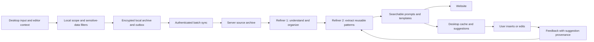

# Technical design

> **Documentation scope (31 October 2026): Historical plan or implementation snapshot.** The original body is preserved for context. Its proposed stack, milestones and then-current feature claims are superseded by current guidance. [Core objective](CORE_OBJECTIVE.md) | [Documentation index](DOCUMENTATION_INDEX.md)

Status: proposed, 19 October 2026. Choices below are implementation decisions to validate, not claims that a recorder or service already exists. External capability evidence is in [RESEARCH.md](RESEARCH.md).

## 1. Product flow

The user installs Pomte on Windows and Mac, signs in, selects capture scope, and continues working. A tray/menu-bar indicator shows recording, pause, exclusions, and sync state. A local archive is usable offline. The service processes synchronized items and sends reusable knowledge back to the connected devices.



The cloud sees only records eligible for synchronization. Raw device event streams remain local by default; retained prompt text and source metadata sync automatically after account connection and sync enablement. A visible option can retain/sync additional permitted drafts. Excluded material never becomes part of the archive.

## 2. Technology choices

| Layer | Proposed choice | Reason / alternative |
| --- | --- | --- |
| Desktop shell | Tauri 2, React, TypeScript, Vite | Shared interface code, tray, native Rust backend. Electron remains a fallback if the native/webview prototype fails important requirements. |
| Collector core | Rust, separate Windows and macOS implementations | Shared policy/reconciliation logic; OS-specific APIs remain isolated. Evaluate rdev rather than assuming it covers everything. |
| Windows native access | Windows APIs and UI Automation | Foreground context and focused text access, without requiring permanent administrator privileges. |
| macOS native access | Core Graphics event observation, Accessibility, app activation context | Separate capabilities; preserve visible degraded states when permission is absent. Small Swift/Objective-C bridge only if Rust bindings are insufficient. |
| Local database | SQLite with SQLCipher Community, accessed only through Rust | Durable queue and encrypted searchable local data. Cross-platform build/encryption proof is an early gate. |
| Device secrets | Windows OS-protected secret storage; macOS Keychain | Store random local database keys and revocable device tokens outside the UI bundle. Verify library/backend behavior in the spike. |
| Web | Next.js with TypeScript | Account, archive, template editor, and HTTP API in one deployable application initially. |
| Background jobs | Separate TypeScript worker, PostgreSQL-backed jobs | No long model request in an HTTP ingestion handler. Avoid Redis in the first deployment. |
| Server database | PostgreSQL, full-text search, pgvector later | One datastore for users, sync records, jobs, and hybrid retrieval. |
| Identity | Established OAuth/OIDC or maintained session library | No custom password cryptography. Desktop login through system browser and device-scoped tokens. |
| Model layer | Small provider-neutral interface with structured outputs | Provider/model selection occurs before AI implementation; credentials stay server-side. No training pipeline in v1. |
| Packaging | Signed Windows installer; signed/notarized Mac download; signed updates | Direct distribution first. Validate supported OS/architecture matrix in release testing. |

Do not bundle a large local model, screenshots, video, or continuous audio in the first release. Capture dictated text through supported editor snapshots. Dedicated dictation is later work.

If SQLCipher packaging fails, evaluate application-encrypted payloads with an in-memory search index. Never silently fall back to a plaintext archive or plaintext full-text index.

## 3. Capture design

### Multiple sources, one recorder

| Source | Role | Confidence boundary |
| --- | --- | --- |
| Input events | Broad activity observation, edit triggers, typing pauses | Not a reliable final document by themselves |
| Focused editor snapshot | Current text and selection where exposed | May be partial, stale, or unavailable |
| Foreground app/window | Source context and session boundaries | Browser app does not prove a website or project |
| Browser adapter | Prompt-box text, domain, conversation, submission evidence | Per-site maintenance and explicit site permission |
| Agent hook | Complete submitted text and available session/workspace IDs | Supported configuration/version only; not live draft access |
| Explicit capture shortcut | Save selected text in unsupported surfaces | User action, with clearly recorded source quality |

The broad recorder remains central. Native hooks and browser adapters are additional evidence sources, not a replacement for that direction.

### Collection lifecycle

States: `disabled`, `recording`, `paused_by_user`, `excluded_surface`, `permission_missing`, `protected_input`, `context_unknown`, `degraded`.

1. Receive a focus/input notification with monotonic sequence and wall-clock timestamp.
2. Resolve current surface and local capture policy before retaining text.
3. For an approved surface, schedule a bounded text snapshot after a typing pause; prefer events over continuous polling.
4. Reconcile the snapshot with prior text/selection. Keep source observations separate when they disagree.
5. Detect submission only when an adapter/hook or strong surface-specific signal confirms it. Enter alone is not sufficient.
6. End or split a segment on focus/editor/session changes. Mark incomplete or ambiguous captures explicitly.
7. Apply sensitive-data filtering before durable writes and again before sync.
8. Commit retained record and outbox item atomically.

Starting debounce proposal: 500 ms after input, with a maximum snapshot rate of 2 Hz per active editor. Tune on measured accuracy and resource use. Native callbacks must not block on accessibility, disk, AI, or network work. Queue overflow creates a visible gap record, not silent loss or unbounded memory use.

### Scope and exclusion policy

Onboarding explicitly enables collection. Initial scope is the user's selected AI/development apps and browser sites; optional broader capture uses the same collector. The app shows a preview of retained data and allows scope changes without rebuilding it.

Never retain identified password/protected fields. Exclude credential managers, authentication/payment surfaces, and user exclusions. In broad capture, an unclassified editor is a gap until the surface can be classified; permission alone is not sufficient evidence it is safe to persist. Do not recover protected text through another source.

Filters include recognized token/key patterns, private-key blocks, and user-defined redactions. They are imperfect; avoid any promise of complete secret detection. Browser UI can mix safe and sensitive tabs, so process-level allowlisting alone is insufficient for broad browser collection.

## 4. Records and provenance

Use opaque random IDs. Store UTC timestamps and display the user's selected timezone; default to Asia/Calcutta for this user's account. Use device sequence numbers for local order and server cursors for synchronization order. Device clock timestamps are not conflict-resolution authority.

| Entity | Important fields |
| --- | --- |
| Device | account ID, device ID, display name, OS, app version, token status, last sync, capture capabilities |
| Observation | ID, device ID/sequence, time, adapter/version, event kind, editor/session IDs, app, permitted URL/window metadata, filtered payload, quality flags |
| Prompt | ID, retained original text, source observation IDs, capture method, submission status, project assignment evidence, created time, deletion state |
| Understanding | prompt ID, intent, instruction spans, task variables, language, project-local facts, exclusions/constraints, source span references, pipeline version |
| Template | ID, title, task type, scope, reusable text, named fields, supporting prompt IDs, candidate/active/suppressed state, version, last used |
| Preference | original user wording, proposed interpretation, scope, supporting sources, explicit/inferred status, current/superseded state |
| Feedback | suggestion ID, template version, surface, accepted/edited/dismissed action, inserted span IDs; no unrelated keystroke telemetry |
| Sync operation | ID, entity ID/type, device sequence, base version, policy revision, account generation, payload hash, state, retry time |

“Raw” means retained source text after capture exclusions/redaction. The system cannot promise both removal of credentials and byte-for-byte retention of excluded content. Never rewrite retained source text in place; corrected interpretations are versioned derived records.

Prefer source message/session IDs for duplicate detection. Otherwise propose duplicate links using device/time/surface/text evidence. Never merge distinct prompts solely because their text is identical: repeating the same instruction is useful learning evidence. Hashes used for integrity/deduplication are account-scoped; no cross-user content matching.

Initial retention proposal, configurable: low-level observations 7 days; retained historical prompts 365 days; active templates until deletion. A user who wants longer history can extend prompt retention. Cap disk/queue use and show backlog warnings; do not silently discard unacknowledged records.

## 5. Sync contract

### Proposed endpoints

| Endpoint | Purpose |
| --- | --- |
| `POST /v1/devices/authorize` | Start browser-based device sign-in |
| `POST /v1/sync/handshake` | Check device status, account generation, policy revisions, and deletion barriers |
| `POST /v1/sync/push` | Submit a bounded idempotent batch of retained records/edits |
| `GET /v1/sync/pull?cursor=...` | Receive changes and tombstones after a server cursor |
| `POST /v1/entities/{id}/delete` | Create an authoritative deletion operation |
| `POST /v1/devices/{id}/revoke` | Stop that device's server access |
| `POST /v1/search` | Search account/project-scoped history and templates |
| `POST /v1/templates/{id}/feedback` | Record feedback for a specific suggestion/template revision |

Exact authentication schema and routes are finalized in milestone M2. Account identity always comes from authentication, not a trusted client-supplied owner field.

### Outbox behavior

Commit source record and upload intent in one local transaction. On reconnect, handshake and apply deletion/policy changes before pushing queued content. Bound batch count and byte size; handle oversized items explicitly. Retry transient failures with exponential backoff and jitter. Refresh authentication on expiry; stop and display status for revoked credentials. Never delete local queue entries based only on an HTTP timeout or an aggregate batch success.

Server uniquely indexes `(account_id, operation_id)` and acknowledges individual accepted, duplicate, rejected, and tombstoned operations. Persist ingestion and its processing-job intent transactionally. Job execution is at-least-once and must be idempotent using input revision and pipeline version.

Append-only prompt records avoid most merge conflicts. Editable templates use server versions and optimistic concurrency: stale edits return a conflict copy rather than silently overwriting the other computer's changes. No CRDT is needed for v1 because there is no simultaneous collaborative document editing.

### Deletion and stale computers

Deletion is an exception to normal append-only history. Purge source payloads and affected derived text/embeddings/search caches; recompute shared templates from remaining sources or suppress them. Keep minimal ID-only tombstones for the supported sync lifetime. Account wipe increments an account generation and invalidates old queued writes; stale devices must re-enroll/reset before any upload.

An offline device processes deletions on its next successful connection. Do not promise immediate remote deletion on a disconnected computer. Backups have a separately published expiry window; restore replays deletion metadata before serving data. Exports already made by a user cannot be recalled.

## 6. Understanding and generalization

### Refiner 1: understand each prompt

Process only retained, eligible records. Normalize text for search without changing source wording. Extract structured task intent, instruction spans, project-specific facts, scope/negations, variable parts, and language. Preserve code, file paths, and named entities until explicitly identified as variable parts. Unknown project stays unknown.

### Refiner 2: find reusable patterns

Retrieve similar prior prompts using keyword and semantic signals, then compare small groups. Generate candidates for whole templates, reusable instruction blocks, preferences, or project-local memory. Repeated phrasing is evidence, not a permanent command. A one-time restriction such as “research only today” must not become an always-on preference.

Initial heuristic: seek at least three independent user-authored examples before labelling a recurring pattern. This threshold is a tuning parameter, not a confidence guarantee. Automatically create candidates without requiring manual filing. First use shows an editable suggestion; only explicitly pinned preferences enter automatic context injection later.

Store supporting prompt IDs and spans, pipeline/prompt/model versions, and validation results. Validate structured output, field names, source references, preserved negations, project scope, and changes to requested authority. Treat captured text as untrusted data; refiners have no shell/browser/email tools and cannot execute instructions contained in records.

User and assistant text have separate provenance. Assistant replies may supply optional context, but must not be treated as user preferences or successful-work evidence. Inserted AI suggestions must not count as independent repeated human instructions. Capture feedback after editing, without pretending acceptance proves improved results.

### Processing frequency and budget

Ingestion completes before AI work. Incremental understanding runs after sync; grouping runs on new/changed items and a user-local daily schedule. Never send a model request for every key event. Chunk large records, cache work by source revision/pipeline, bound model input/output, and impose per-account daily limits. Failed model work leaves source history usable.

The AI provider is intentionally unselected. Before implementation, configure the provider and credentials through the supported setup workflow. No key is required to build deterministic capture, storage, sync, or mock refiners.

## 7. Retrieval and insertion

First ship a global shortcut that opens a desktop picker: search, project badge, original/derived toggle, and copy/insert. A project chip can be changed with one action. Rank task relevance before recency so a useful months-old prompt can resurface.

Next introduce an unobtrusive suggestion panel after typing pauses in supported surfaces. Show at most three results, with brief source context and an easy dismiss action. Start with local keyword/fuzzy search over cached templates; add server hybrid retrieval for historical searches. Local semantic indexing is optional after measurement.

Every asynchronous suggestion is tied to `(surface_id, draft_revision)`. Discard stale results after focus/text changes. Before insertion, verify the target is still the same permitted editor. Insert only after a user action; never press Send/Enter automatically. Preserve or restore the clipboard only if no other application/user has changed it since our operation.

First prefer original/reusable text retrieval. AI adaptation to the current project is a separate explicit action with a preview; do not add permissions, implementation scope, files, or a different goal without evidence.

## 8. Application and service boundaries

The Rust backend owns local keys, database access, capture, and sync. The React webview receives only narrow validated commands. It cannot run arbitrary shell commands or queries. Bundle desktop UI locally; open external content in the system browser. Do not load the website with native recording capabilities.

Use authenticated native messaging or an authenticated named-pipe/Unix-socket bridge for browser/agent integration. If a loopback HTTP bridge is later required, use per-install authentication, origin checks, bounded payloads, and explicit pairing; CORS alone is not authentication.

Cloud mode uses transport and storage encryption but is not server-blind end-to-end encryption: workers must read authorized text to refine it. Publish AI-provider data flow separately. Enforce account/project authorization in every archive, search, feedback, export, worker, and MCP path. Device tokens are independently revocable. Remote revocation stops sync; an offline recorder cannot know about it until reconnection.

No content in application diagnostics or analytics by default. Show pause and local delete in the tray. Protect update signing keys independently from runtime secrets. Maintain notices and a dependency inventory before distributing installers.

## 9. Planned repository structure

```text
apps/
  desktop/               Tauri shell and React interface
  web/                   Next.js website and authenticated HTTP API
  worker/                asynchronous refinement and indexing
crates/
  capture-core/          policy, observations, reconciliation, capabilities
  capture-windows/       Windows events/context/editor access
  capture-macos/         Mac events/context/editor access
  local-store/           encrypted database, outbox, retention
  sync-client/           protocol, retries, authentication state
packages/
  contracts/             JSON Schemas and generated Rust/TS types
  ui/                    shared archive/template components
  refiners/              provider adapter, prompts, validators
  browser-adapters/      later browser-specific integrations
  agent-adapters/        later hooks/integration instructions
fixtures/                synthetic capture/sync/refiner evaluation data
docs/                    research, design, milestones, measured coverage
```

This is a layout proposal; empty scaffold directories have not been created.
